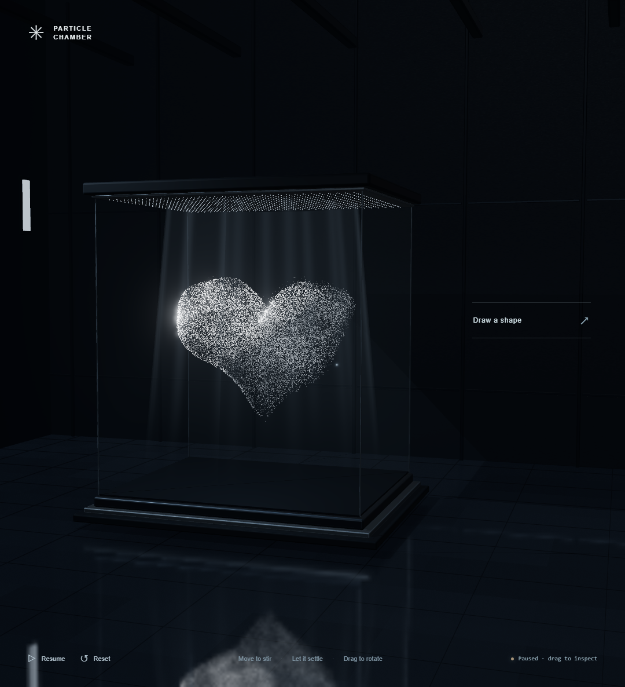

# Particle Chamber

A small browser artwork for drawing and playing with particles. Sketch an
outline to make a rounded 3D shape, then move the mouse through it.



[Default form](docs/default.png) · [Interaction recording](docs/interaction.webm)

Click **Draw a shape** at the side, draw one outline, then **Make particles**.
The particles keep flowing; moving the mouse carries nearby particles along.
Drawn shapes drift and deform with the flow. Drag, or focus the
cabinet and use the arrow keys, to look around. **Pause / Resume** controls
movement, **Clear** empties the drawing pad, and **Reset** restores the default cloud.

## Run

With Node.js 18 or later, run from this folder. No extra packages or online
services are needed.

```bash
node server.mjs
```

Open <http://127.0.0.1:8000>. Stop: Ctrl+C.

## Limits

All devices use 32,768 particles at native pixel resolution, with bloom,
reflections and shadows. WebGL 2 and floating-point render targets are required;
slower devices may lag. One closed outline at a time; thickness is estimated.
Drawings are not saved after reload.
